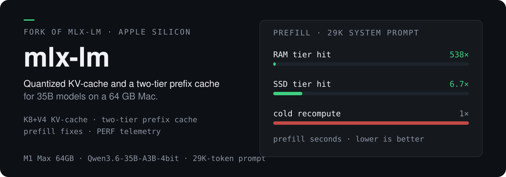
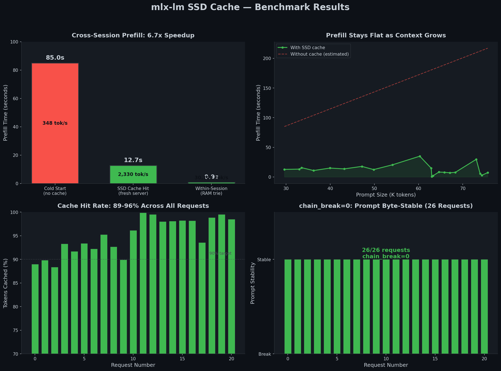

<p align="center">
  
</p>

# mlx-lm fork — long-context prefill on Apple Silicon

Fork of [ml-explore/mlx-lm](https://github.com/ml-explore/mlx-lm) adding a quantized KV-cache and a two-tier (RAM + SSD) prefix cache, aimed at running Qwen 3.6 models (35B MoE, 27B) for long agent workloads like [Hermes Agent](https://hermes-agent.nousresearch.com/) on M-series Macs.

Everything here operates on the key-value cache. No model weights change, and no new architectures are introduced.

**The problem.** A 35B MoE model on a 64GB M1 Max uses ~25-30GB for weights, leaving ~34GB for KV cache. One 45K-token conversation fills 6-8GB. Long agent sessions run out of RAM, hit swap, and slow to a crawl.

## What this fork changes

All of the below is this fork's work on top of [upstream](https://github.com/ml-explore/mlx-lm):

- **Quantized KV-cache (K8+V4).** Asymmetric precision — keys at 8-bit, values at 4-bit — with separate group sizes `(64, 32)` and the first/last 2 KV layers kept at K8+V8. About 30% KV memory savings at 128K context. Based on [KIVI (NeurIPS 2024)](https://arxiv.org/abs/2402.02750). Flags: `--kv-bits "(8, 4)" --kv-group-size "(64, 32)" --kv-boundary-layers 2`.
- **Two-tier prefix cache (RAM + SSD).** The RAM tier is a `PromptTrie` plus an LRU hot cache; the SSD tier is `BlockSSDCache`, storing 256-token safetensor blocks chained by `SHA256(parent_hash || model_key || block_tokens)`. Conversations survive server restarts. Flags: `--block-ssd-cache-dir`, `--block-ssd-cache-max-size`, `--prompt-cache-size`.
- **Prefill reliability fixes.** A prompt-tag truncation bug, missing `ArraysCache.trim()`, lost `pop_prefixes` checkpoints, a missing `max_tokens` default, and a direct chat-marker boundary scan that cuts system-boundary detection from ~50ms to <1ms.
- **Cache observability.** One `PERF` line per request reports `pref_tok`, `block_hit`, `block_write`, and `chain_break`, so cache regressions are visible in logs.

## Benchmarks

**Hardware:** M1 Max 64GB | **Model:** Qwen3.6-35B-A3B-UD-MLX-4bit | **Prompt:** 29K-token Hermes agent system prompt

| | prefill | tok/s | cached |
|---|---|---:|---:|
| Cold (no SSD) | 85.01s | 348 | 0% |
| SSD hit (run 2) | 12.71s | 2,330 | 89% |
| Within-session (RAM trie) | 0.90s | 30,101 | 99.9% |

**6.7x** cross-session prefill speedup, **538x** within-session. Within-session serving reaches ~30,000 tok/s.

Prefill stays flat (~13-18s) as the prompt grows from 29K to 47K tokens, because only the new delta is recomputed:

| prompt_tok | pref_tok | cached | chain_break | prefill |
|---|---|---|---|---|
| 29,629 | 3,261 | 89% | 0 | 12.78s |
| 33,019 | 3,360 | 90% | 0 | 13.22s |
| 39,943 | 3,318 | 92% | 0 | 15.01s |
| 47,165 | 3,672 | 92% | 0 | 17.83s |
| 63,297 | 302 | 99.5% | 0 | 2.20s |
| 75,641 | 1,143 | 98.5% | 0 | 7.37s |

`chain_break=0` on every request — the prompt is byte-stable across 21 requests.



Full data: [docs/SSD_CACHE_BENCHMARK_FIX_ABC.md](docs/SSD_CACHE_BENCHMARK_FIX_ABC.md).

## Quick start

```bash
# 1. Clone the fork
git clone https://github.com/shivam2014/mlx-lm.git mlx-lm-vanilla
cd mlx-lm-vanilla/mlx-lm

# 2. Create virtual environment and install
python3 -m venv venv
source venv/bin/activate
pip install -e .

# 3. Launch the server
mlx_lm.server \
  --model ~/.cache/huggingface/hub/Qwen3.6-35B-A3B-UD-MLX-4bit \
  --host 127.0.0.1 --port 8000 \
  --chat-template-args '{"enable_thinking": false}' \
  --kv-bits "(8, 4)" --kv-group-size "(64, 32)" \
  --block-ssd-cache-dir ~/.cache/mlx-lm/block_ssd_cache \
  --block-ssd-cache-max-size 50 \
  --prompt-cache-size 10
```

For reasoning output, swap the template args for `'{"enable_thinking":true, "preserve_thinking": true}'` and launch via `python3 -m mlx_lm server`. See [Thinking mode](#thinking-mode) and the [recommended flags](#recommended-flags).

## How the cache works

```
                    fetch_nearest_cache(model, tokens)
                                 |
                 +---------------+---------------+
                 |  RAM tier (fast)              |
                 |   PromptTrie -> LRU hot cache |
                 |   hit: deepcopy, ~30,000 tok/s|
                 +---------------+---------------+
                                 | miss
                 +---------------+---------------+
                 |  SSD tier (persistent)        |
                 |   BlockSSDCache               |
                 |   256-token safetensor blocks |
                 |   chain: SHA256(parent_hash   |
                 |     || model_key || tokens)   |
                 |   hit: deserialize + promote  |
                 +-------------------------------+
```

### KV cache quantization

At FP16, each KV cache layer costs ~384MB at 128K context. With 10 KV layers on Qwen3.6-35B, that is ~3.8GB of cache alone — on top of 28-30GB of weights, leaving little headroom before swap.

```
                    FP16    K8+V4    K8+V4 + boundary
KV cache (128K)    3.8 GB   2.7 GB   2.76 GB
Model weights      20 GB    20 GB    20 GB
Peak RAM           ~30 GB   ~28 GB   ~28 GB
Headroom (64GB)    ~34 GB   ~36 GB   ~36 GB
```

Asymmetric on purpose. Keys participate in the attention dot product, so noise there directly shifts which tokens the model attends to. Values are softmax-weighted sums — a low-pass filter that tolerates more compression.

Boundary layers (first 2 + last 2 KV layers) stay at K8+V8 because they handle input embedding projection and final logit transformation, where quantization noise compounds. Middle layers operate on already-abstracted representations where V4 is fine.

```bash
--kv-boundary-layers 2 --kv-boundary-bits "(8,8)"   # default
--kv-boundary-layers 0                               # disable
```

**Why not TurboQuant?** It compresses KV cache to ~3 bits using Walsh-Hadamard transforms. For Qwen 3.6 hybrid architectures (`full_attention_interval=4`), only 10 of 40 layers have KV caches, so the total KV cache is 1-3GB at 128K context. Moving from K8+V4 to 3-bit saves ~80MB (35B-A3B) or ~256MB (27B) — not enough to justify the WHT compute overhead. K8+V4 with boundary protection is the sweet spot for these models.

Reference: [KIVI (Liu et al., NeurIPS 2024)](https://arxiv.org/abs/2402.02750).

### Two-tier prefix cache

The RAM prompt cache (`LRUPromptCache`) holds KV entries in memory. Restart the server and it is gone — every conversation starts from a full 85-second prefill.

The SSD tier persists each 256-token block as a safetensors file on disk, chained via hash: `SHA256(parent_hash || model_key || block_tokens)`. On startup, the 64 most-recent blocks are pre-loaded into an in-memory LRU hot cache (~52ms).

```bash
--block-ssd-cache-dir ~/.cache/mlx-lm/block_ssd_cache
--block-ssd-cache-max-size 50   # GB
```

**What it cost to get right.** The initial implementation had four performance bugs that regressed prefill from ~650 tok/s to 4.5 tok/s. All are fixed:

| Bug | Root cause | Fix |
|-----|-----------|-----|
| No hot cache | Every SSD hit read from disk | LRU `_hot_cache` in RAM |
| Per-block `mx.eval` | 120 GPU sync points during prefill | Batch eval after all blocks load |
| Deep copy overhead | `copy.deepcopy()` per block per layer | Direct `mx.load()` without intermediary |
| Eviction thrashing | `_maybe_evict()` called per block save | Deferred to post-request flush |

## Reliability fixes

Caching with asymmetric KV quantization is tricky. Several upstream issues caused silent cache corruption or missed reuse:

- **Prompt-tag bug** — `max_tokens` truncation injected wrong tags into cached prefixes, poisoning subsequent requests (5-part fix across `_serve_single`, `_tokenize`, and segment handling).
- **`ArraysCache` trim** — multimodal models use `ArraysCache` for non-KV layers, but `trim()` was not implemented, causing crashes on prefix trim.
- **`pop_prefixes` checkpoints** — intermediate system/user checkpoints were lost during prefix operations, breaking the trie invariant.
- **`max_tokens` default** — a missing `max_tokens` in the API request caused silent response truncation.
- **Template boundary detection** — replaced the `apply_chat_template` re-encode + byte-compare in `_tokenize` with a direct token-ID scan for chat markers (`<|im_start|>` / `<|im_end|>`). Cuts system-boundary detection from ~50ms to <1ms and works for any model family with resolvable marker tokens (Qwen, Llama 3+, etc.), falling back gracefully for unknown templates.

These fixes are what make cache hits return correct results, not just fast ones.

## Observability

Every request logs a single `PERF` line with full cache health:

```
PERF: prompt_tps=2330.4 prompt_tok=29624 pref_tok=3256 prefill=12.71s
      block_hit=103 block_write=0 chain_break=0
```

| Field | Meaning |
|-------|---------|
| `pref_tok` | Tokens actually recomputed (not served from cache) |
| `block_hit` | Blocks loaded from SSD this request |
| `block_write` | New blocks written to SSD |
| `chain_break` | 1 = block-0 prefix mismatch (prompt drifted) |

```bash
# Find cache regressions
grep "PERF:" server.log | grep "chain_break=1"

# Find requests with no cache reuse
grep "PERF:" server.log | grep "pref_tok=[0-9]\{4,\}"
```

## Recommended flags

The flags that make this fork worth using over upstream, sized for a production Hermes agent setup on M1 Max 64GB:

| Flag | Value | What it does | Why you want it |
|------|-------|-------------|-----------------|
| `--kv-bits` | `"(8, 4)"` | Keys at 8-bit, values at 4-bit | ~30% KV memory savings. Keys need precision (attention dot product), values tolerate compression (softmax-weighted sums). |
| `--kv-group-size` | `"(64, 32)"` | Separate group sizes for K and V | Smaller groups for V (32) compensate for lower bit-width. Keys use 64 for speed. |
| `--kv-boundary-layers` | `2` | Protect first 2 + last 2 KV layers at K8+V8 | Boundary layers handle input projection and logit output — most sensitive to quantization noise. |
| `--block-ssd-cache-dir` | — | Persist KV blocks to SSD | Survives server restarts. Without this, every restart recomputes the full system prompt from scratch. |
| `--block-ssd-cache-max-size` | `50` | SSD cache limit in GB | A 29K-token system prompt uses ~40GB in blocks. 50GB gives headroom for a few sessions. |
| `--prompt-cache-size` | `10` | Keep N most-recent KV caches in RAM | Higher values use more RAM but reduce SSD round-trips. 10 is enough for typical agent sessions. |

### Thinking mode

For models that support reasoning (Qwen3.6-35B-A3B, Qwen3.5-27B), add `--chat-template-args` with both flags:

```bash
--chat-template-args '{"enable_thinking":true, "preserve_thinking": true}'
```

| Flag | Effect |
|------|--------|
| `enable_thinking: true` | Instructs the model to produce a `<think>...</think>` block before answering |
| `preserve_thinking: true` | Keeps the thinking block in the response stream (instead of stripping it) |

The response will include a `reasoning` field alongside `content` in the chat completion payload.

> **Debug mode** — pipe server logs to a file for post-mortem analysis:
> ```bash
> python3 -m mlx_lm server \
>   --model ~/.cache/huggingface/hub/Qwen3.6-35B-A3B-UD-MLX-4bit \
>   --host 127.0.0.1 --port 8000 \
>   --chat-template-args '{"enable_thinking":true, "preserve_thinking": true}' \
>   --kv-bits "(8, 4)" --kv-group-size "(64, 32)" \
>   --block-ssd-cache-dir ~/.cache/mlx-lm/block_ssd_cache \
>   --block-ssd-cache-max-size 50 \
>   --log-level DEBUG \
>   --prompt-cache-size 10 2>&1 | tee /tmp/server_bench.log
> ```

## What's next: DFlash

[DFlash](https://huggingface.co/collections/z-lab) models are distilled/optimized variants of Qwen 3.5 and 3.6, in 27B and 35B-A3B sizes. The SSD caching infrastructure here makes iterative testing on DFlash variants practical — long benchmark sessions survive server restarts without losing the prefix cache.

Models in cache: `Qwen3.5-27B-DFlash`, `Qwen3.5-35B-A3B-DFlash`, `Qwen3.6-35B-A3B-DFlash`.

## Attribution

- [ml-explore/mlx-lm](https://github.com/ml-explore/mlx-lm) — upstream
- [KIVI (Liu et al., NeurIPS 2024)](https://arxiv.org/abs/2402.02750) — asymmetric quantization
- [TurboQuant+](https://github.com/TheTom/turboquant_plus) — boundary-aware compression
- [jundot/omlx](https://github.com/jundot/omlx) — `paged_ssd_cache.py` reference
- [Goose #4610](https://github.com/block/goose/issues/4610) — timestamps preventing LLM caching
- [EPIC (2410.15332)](https://arxiv.org/abs/2410.15332) — position-independent caching
- [Prompt Cache (2311.04934)](https://arxiv.org/abs/2311.04934) — modular attention reuse
- [CacheBlend (2405.16444)](https://arxiv.org/abs/2405.16444) — selective KV recomputation
- [Luce Org / lucebox-hub](https://github.com/Luce-Org/lucebox-hub) — prefix cache boundary detection and deferred-eviction patterns
